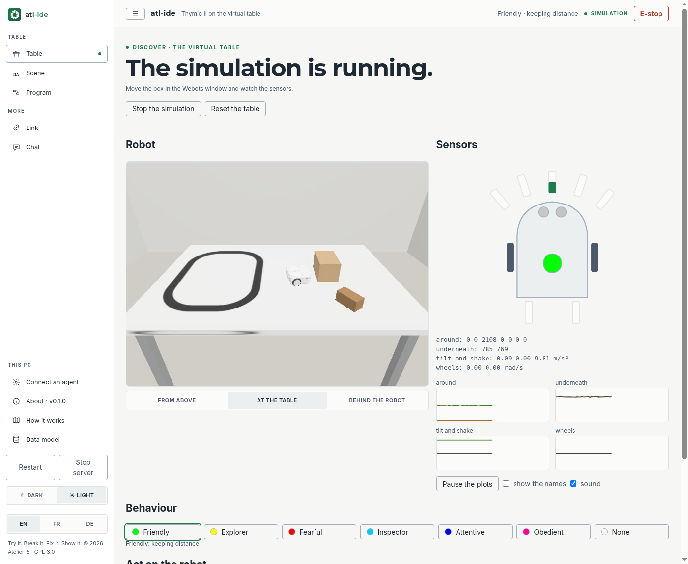

<p align="center"></p>

# atl-ide: the Atelier-5 robotics IDE

🇬🇧 [English](#english) · 🇫🇷 [Français](#français) · 🇩🇪 [Deutsch](#deutsch)

**v0.1 · Discover**: one Thymio II on a white table (1.2 × 0.8 m, open edges) with a black line, a carton box and a wooden block.

---

## English

A Thymio II on a virtual table: watch what it senses, drive it, start its built-in behaviours.
*Try it. Break it. Fix it. Show it.*

### Run it

It needs **Webots R2025a** (`sudo snap install webots`), **Docker** and the robot's body, the image of
[atl-bot-thymio](https://github.com/Atelier-5/atl-bot-thymio) (ROS 2 Kilted, so it runs on any host):

```bash
(cd ../atl-bot-thymio && docker build -f docker/Dockerfile -t atl-bot-thymio:kilted .)
./run.sh                                   # http://127.0.0.1:8780 → Start the simulation
./test.sh                                  # the tests: no Webots, no Docker
.venv/bin/python scripts/selftest-twin.py  # the whole chain, headless, about 2 minutes
```

**Start the simulation** writes the table (`atl/world.py` → `mydocs/twin/`), opens it in Webots, starts the
robot's body in its container and waits until the sensors report. Closing the Webots window stops it all.
It works from any terminal, PyCharm's included.

### What is on the Table screen

| | |
|---|---|
| **Robot** | the table's camera, seen **from above**, **at the table** or **behind the robot** |
| **Sensors** | the Thymio from above with its 7 + 2 sensors and top LED; readings and rolling plots |
| **Behaviour** | the six built-in behaviours, each with its colour: Friendly, Explorer, Fearful, Inspector, Attentive, Obedient |
| **Act** | drive (the arrow pad or the keyboard's arrows), the robot's five buttons, clap 1–3, lift and put down |
| always | **E-stop**, **Reset the table**, and **sound**: the tunes and beeps the real Thymio plays |

Sensor names stay hidden until a facilitator shows them: the group discovers first, names come after.

### An agent at the table

The robot is described by an **ontology** (SOSA/SSN, SKOS, SHACL): the rules in `atl/edge/ontology/`, the
robot's own description in its image (served at `/robot.ttl`). With `.mcp.json`, an agent can read the robot,
its live sensors and its commands freely. What it wants the robot to do is **checked against the shapes**, then
**proposed** in the chat: a facilitator confirms it. The E-stop is never a proposal.
The drawings are in the app: **How it works** (`/how`) and **Data model** (`/model`).

---

## Français

Un Thymio II sur une table virtuelle : observe ce qu'il perçoit, conduis-le, lance ses comportements.
*Essayer. Démonter. Réparer. Montrer.*

### Lancer

Il faut **Webots R2025a** (`sudo snap install webots`), **Docker** et le corps du robot, l'image de
[atl-bot-thymio](https://github.com/Atelier-5/atl-bot-thymio) (ROS 2 Kilted, pour tourner sur n'importe quel PC) :

```bash
(cd ../atl-bot-thymio && docker build -f docker/Dockerfile -t atl-bot-thymio:kilted .)
./run.sh                                   # http://127.0.0.1:8780 → Lancer la simulation
./test.sh                                  # les tests : sans Webots, sans Docker
.venv/bin/python scripts/selftest-twin.py  # toute la chaîne, sans fenêtre, environ 2 minutes
```

**Lancer la simulation** écrit la table (`mydocs/twin/`), l'ouvre dans Webots, démarre le corps du robot dans
son conteneur et attend que les capteurs répondent. Fermer la fenêtre de Webots arrête tout.

### L'écran Table

| | |
|---|---|
| **Robot** | la caméra de la table, vue **d'en haut**, **à la table** ou **derrière le robot** |
| **Capteurs** | le Thymio vu d'en haut, ses 7 + 2 capteurs et sa lumière ; les valeurs et leurs courbes |
| **Comportement** | les six comportements du Thymio, chacun avec sa couleur : Amical, Explorateur, Peureux, Enquêteur, Attentif, Obéissant |
| **Agir** | conduire (les flèches), les cinq boutons du robot, taper dans les mains 1 à 3 fois, le soulever et le reposer |
| toujours | **Arrêt d'urgence**, **Remettre la table en place**, et le **son** : les mélodies et bips du vrai Thymio |

Les noms des capteurs restent cachés jusqu'à ce qu'un animateur les montre : le groupe découvre d'abord, les noms viennent après.

### Un agent à la table

Le robot est décrit par une **ontologie** (SOSA/SSN, SKOS, SHACL). Un agent lit librement le robot, ses capteurs
et ses commandes. Ce qu'il veut faire faire au robot est **vérifié par les formes SHACL**, puis **proposé** dans le
chat : un animateur le confirme. L'arrêt d'urgence n'est jamais une proposition.

---

## Deutsch

Ein Thymio II auf einem virtuellen Tisch: sieh, was er wahrnimmt, fahre ihn, starte seine Verhalten.
*Probieren. Zerlegen. Reparieren. Zeigen.*

### Starten

Nötig sind **Webots R2025a** (`sudo snap install webots`), **Docker** und der Körper des Roboters, das Image von
[atl-bot-thymio](https://github.com/Atelier-5/atl-bot-thymio) (ROS 2 Kilted, damit es auf jedem PC läuft):

```bash
(cd ../atl-bot-thymio && docker build -f docker/Dockerfile -t atl-bot-thymio:kilted .)
./run.sh                                   # http://127.0.0.1:8780 → Simulation starten
./test.sh                                  # die Tests: ohne Webots, ohne Docker
.venv/bin/python scripts/selftest-twin.py  # die ganze Kette, ohne Fenster, etwa 2 Minuten
```

**Simulation starten** schreibt den Tisch (`mydocs/twin/`), öffnet ihn in Webots, startet den Körper des Roboters
in seinem Container und wartet, bis die Sensoren antworten. Das Webots-Fenster schließen hält alles an.

### Der Tisch-Bildschirm

| | |
|---|---|
| **Roboter** | die Kamera des Tisches, **von oben**, **am Tisch** oder **hinter dem Roboter** |
| **Sensoren** | der Thymio von oben mit seinen 7 + 2 Sensoren und dem Licht; Werte und Verläufe |
| **Verhalten** | die sechs Verhalten des Thymio, jedes mit seiner Farbe: Freundlich, Entdecker, Ängstlich, Inspektor, Aufmerksam, Gehorsam |
| **Handeln** | fahren (die Pfeile), die fünf Tasten des Roboters, 1–3 Mal klatschen, hochheben und absetzen |
| immer | **Not-Halt**, **Tisch zurücksetzen** und **Ton**: die Melodien und Pieptöne des echten Thymio |

Die Namen der Sensoren bleiben verborgen, bis eine Begleitperson sie zeigt: die Gruppe entdeckt zuerst, die Namen kommen danach.

### Ein Agent am Tisch

Der Roboter ist durch eine **Ontologie** beschrieben (SOSA/SSN, SKOS, SHACL). Ein Agent liest den Roboter, seine
Sensoren und Befehle frei. Was er den Roboter tun lassen will, wird **mit den SHACL-Formen geprüft** und dann im
Chat **vorgeschlagen**: eine Begleitperson bestätigt es. Der Not-Halt ist nie ein Vorschlag.

---

From the D-LAB-5 tool and edge templates, as
[digitalhome-twin-edge-WormBed-5](https://github.com/DigitalHome-cloud/digitalhome-twin-edge-WormBed-5).

## License · Licence · Lizenz
GPL-3.0-or-later. The name "Atelier-5" and its logos are reserved for modified versions (GPLv3 §7(e),
see [atl-hub/TRADEMARKS.md](https://github.com/Atelier-5/atl-hub/blob/main/TRADEMARKS.md)).
